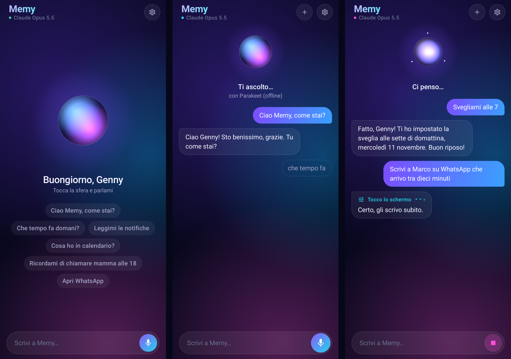

# Memy — assistente vocale IA per Android

Memy è un'assistente personale per Android. Le parli, il "cervello" (Claude di Anthropic) capisce cosa vuoi e Memy
agisce sul telefono: apre e **usa le app al posto tuo**, legge e risponde alle notifiche, gestisce sveglie, calendario,
promemoria, chiamate e messaggi. Poi ti risponde con una voce neurale naturale e **gratuita** (Microsoft Edge).

Pensata per l'installazione diretta tramite APK, senza Play Store, e compatibile con telefoni **senza servizi Google**
(ad esempio vivo con OriginOS versione Cina).



## Cosa sa fare

| Area | Esempi |
|---|---|
| Conversazione | "Ciao Memy, come stai?", domande di ogni tipo, con **ricerca web** (meteo, notizie, risultati) su tutti i modelli |
| Usare le app | "Scrivi a Marco su WhatsApp che arrivo tra dieci minuti", "Cerca un video di ricette su YouTube", "Attiva il Bluetooth" |
| Notifiche | "Leggimi le notifiche", "Rispondi a Giulia che va bene", "Cancella tutte le notifiche", "Che canzone è questa?" |
| Orologio e agenda | "Svegliami alle 7", "Timer di 10 minuti", "Cosa ho in calendario?", "Crea un evento giovedì alle 15", "Ricordami di chiamare mamma alle 18" |
| Telefono | "Chiama Marco", "Manda un SMS a Giulia", "Leggi gli ultimi SMS", "Chi mi ha chiamato?" |
| Telefono e sistema | Torcia, volume, luminosità, silenzioso, Non disturbare, musica, fotocamera, appunti, email, condivisione |
| Luoghi | "Dove mi trovo?", "Portami in piazza Duomo" |
| Memoria | "Ricordati che mia sorella si chiama Giulia": Memy lo ricorda anche nelle conversazioni future |

Le azioni con effetti reali (inviare, chiamare, pagare, eliminare, pubblicare) chiedono sempre conferma.

## Come funziona

```
Microfono → riconoscimento vocale → Claude (in streaming, con strumenti e ricerca web)
         → azioni sul telefono → voce neurale Edge, frase per frase
```

- **Cervello**: Claude Opus 5.5, Sonnet 5.5 o Haiku 5.5, a scelta, tutti con ricerca web. Per parlare a voce
  il più rapido a rispondere è Sonnet 5.5 (risponde senza la fase di ragionamento iniziale); Opus 5.5 ragiona
  sempre prima di parlare, quindi è più lento.
- **Voce**: le voci neurali di Microsoft Edge (Isabella, Elsa, Diego, Giuseppe e le voci multilingue). Sono
  gratuite, senza account né limiti di crediti. Nelle impostazioni le ascolti in anteprima e regoli velocità e tono.
  È lo stesso servizio "Leggi ad alta voce" del browser Edge, usato con il protocollo della libreria open source
  [edge-tts](https://github.com/rany2/edge-tts). Non è un'API ufficiale: se Microsoft la cambia, Memy usa per un momento
  la voce del telefono finché non arriva un aggiornamento.
- **Ascolto**, a scelta:
  - **Whisper large-v3 su Groq** (consigliato): il modello più preciso per l'italiano, risponde in una frazione di
    secondo. Gratis con una chiave di [Groq](https://console.groq.com/keys) (piano gratuito: 20 frasi al minuto,
    2.000 al giorno, senza carta di credito).
  - **[NVIDIA Parakeet TDT 0.6B v3](https://huggingface.co/nvidia/parakeet-tdt-0.6b-v3)** sul telefono, grazie a
    [sherpa-onnx](https://github.com/k2-fsa/sherpa-onnx): gratuito e senza internet (circa 490 MB da scaricare).
    Se è installato, mostra il testo mentre parli e fa da riserva quando Whisper non è raggiungibile.
  - Google, se sul telefono c'è l'app Google.

  Silero VAD capisce quando inizi e quando finisci di parlare.
- **Conversazione continua**: dopo ogni risposta torna ad ascoltarti. Se tocchi la sfera mentre parla, la interrompi.
- **Ti sente anche fuori dall'app**: durante una conversazione resta attivo un servizio con notifica "Memy". Così,
  mentre lavora in un'altra app, puoi rispondere a voce alle sue domande e conferme. Si spegne da solo pochi secondi
  dopo la fine della conversazione, oppure con il pulsante "Ferma" della notifica.

## I "poteri"

In *Impostazioni → Poteri* decidi quanto può fare Memy. Ognuno si attiva dalle impostazioni di sistema.

| Potere | Cosa permette |
|---|---|
| **Controllo dello schermo** (accessibilità) | Leggere lo schermo e usare qualsiasi app: toccare, scrivere, scorrere, premere i tasti di sistema |
| **Notifiche** | Leggere le notifiche, rispondere ai messaggi, sapere cosa è in riproduzione |
| **Impostazioni di sistema** | Regolare la luminosità |
| **Non disturbare** | Silenzioso e Non disturbare |
| **Permessi** | Microfono, contatti, telefono, SMS, chiamate recenti, calendario, posizione, notifiche |

Sicurezza:

- Memy agisce solo quando glielo chiedi.
- Prima di un tocco che invia, paga, elimina o pubblica compare una richiesta di conferma. Lo decide sia Claude sia un
  controllo automatico sul testo del pulsante.
- Mentre lavora in un'altra app, in alto resta l'indicatore "Memy al lavoro": toccandolo la fermi.
- Memy non inserisce password, PIN o dati di pagamento.
- Le app che proteggono lo schermo (come quelle bancarie) non sono leggibili.

Su Android 13 e successivi, se l'interruttore dell'accessibilità è bloccato:
*Impostazioni → App → Memy → ⋮ → Consenti impostazioni con restrizioni*.

## Costi

Serve solo la chiave di **Claude (Anthropic)**: <https://console.anthropic.com/settings/keys>. Si paga a consumo con una
ricarica prepagata; l'abbonamento Claude Pro non include l'API. Una risposta breve costa indicativamente 0,0005 $ con
Haiku, 0,004 $ con Sonnet e 0,008 $ con Opus. I compiti in cui Memy usa un'app richiedono molti passaggi e costano di più.
La voce e l'ascolto sono gratuiti (Groq ha un piano gratuito; Parakeet gira sul telefono).

## Installazione sul telefono

1. Dal telefono apri la pagina *Releases* di questo repository ("Memy — ultima versione") e scarica `Memy.apk`.
2. Apri il file e consenti l'installazione da questa fonte.
3. Apri Memy e inserisci la chiave di Claude (*Impostazioni → Chiave di Claude*).
4. Aggiungi la chiave gratuita di Groq (*Impostazioni → Chiavi*) e, se vuoi il testo in tempo reale e l'ascolto
   senza internet, scarica anche Parakeet (*Impostazioni → Ascolto*, circa 490 MB, meglio con il Wi-Fi).
   Poi scegli la voce ascoltando le anteprime (*Impostazioni → Voce*).
5. Attiva i poteri che vuoi (*Impostazioni → Poteri*).
6. In *Impostazioni → Sempre pronta* segui i passaggi per OriginOS, così il telefono non chiude Memy.
7. Aggiungi il riquadro **"Ehi Memy"** alle Impostazioni rapide: un tocco e Memy ti ascolta.

## Aggiornamenti automatici

Ogni push su GitHub compila l'APK e aggiorna la release "ultima-versione" (`Memy.apk` e `version.json`).
All'apertura Memy controlla se c'è una versione più nuova; con il Wi-Fi la scarica e la installa da sola, con i dati
mobili mostra un avviso con il pulsante "Aggiorna". La prima volta Android chiede di
consentire a Memy di installare app.

## Note sul cambio di nome

L'app si chiamava Nexa. Per non perdere impostazioni, chiavi e aggiornamenti, alcuni nomi interni restano quelli
storici: l'identificativo `com.nexa.assistant`, il file delle preferenze e la chiave di firma `keystore/nexa-debug.jks`.
L'aggiornamento cerca la release prima in `zsurann/Memy` e poi in `zsurann/Project-Nexa`, quindi funziona sia prima
sia dopo la rinomina del repository.

## Compilare da soli

Servono JDK 17 o successivo e l'SDK Android (piattaforma 36). Al primo build Gradle scarica da GitHub l'AAR ufficiale
di sherpa-onnx 1.13.8 in `app/libs/` e ne verifica l'impronta SHA-256.

```bash
./gradlew :app:testDebugUnitTest --tests 'com.nexa.assistant.agent.*' --tests 'com.nexa.assistant.speech.*' --tests 'com.nexa.assistant.tools.*'
./gradlew :app:testDebugUnitTest --tests '*ScreenshotTest*'   # immagini dell'interfaccia in app/build/screenshots
EDGE_LIVE=1 ./gradlew :app:testDebugUnitTest --tests '*EdgeTtsTest*'   # prova reale della voce Edge (serve internet)

# Prova reale dell'ascolto: la voce Edge legge comandi italiani e Parakeet li trascrive (servono ffmpeg,
# il modello estratto e le librerie native Linux di sherpa-onnx: sherpa-onnx-v1.13.8-linux-x64-jni.tar.bz2)
ASR_LIVE=1 ASR_MODEL_DIR=/percorso/sherpa-onnx-nemo-parakeet-tdt-0.6b-v3-int8 \
  SHERPA_JNI_DIR=/percorso/lib LD_LIBRARY_PATH=/percorso/lib \
  ./gradlew :app:testDebugUnitTest --tests '*ParakeetLiveTest*'
./gradlew :app:assembleRelease                                # APK in app/build/outputs/apk/release/
```

Il file `keystore/nexa-debug.jks` è una chiave di firma di sviluppo inclusa nel repository, così ogni APK si installa
sopra il precedente. Il repository è pubblico, quindi chiunque potrebbe firmare un APK con la stessa chiave: per uso
personale va bene, ma puoi sostituirla impostando `NEXA_KEYSTORE_PASSWORD`, `NEXA_KEY_ALIAS` e `NEXA_KEY_PASSWORD`
(dopo il cambio va disinstallata una volta la versione vecchia).

## Struttura del codice

```
app/src/main/java/com/nexa/assistant/
├── MemyApp.kt, MemyController.kt, MainActivity.kt, MemyTileService.kt
├── MemySessionService.kt  # microfono attivo anche fuori dall'app durante una conversazione
├── agent/      # Ciclo con Claude in streaming, prompt di sistema, divisione in frasi
├── tools/      # Strumenti: base, schermo, notifiche, dati personali, sistema
├── access/     # Servizio di accessibilità e lettura delle notifiche
├── speech/     # Voce Edge (EdgeTts + VoicePlayer); ascolto: VoiceCapture (Silero VAD), Whisper su Groq, Parakeet
├── reminders/  # Promemoria
├── update/     # Aggiornamento automatico da GitHub
├── data/       # Impostazioni, memoria, chiavi cifrate
└── ui/         # Interfaccia Jetpack Compose
```

Per aggiungere uno strumento basta implementare `MemyTool` e registrarlo in `MemyController`.

## Prossimi passi

- Parola di attivazione "Ehi Memy" sempre in ascolto e ruolo di assistente predefinito.
- Routine ("quando arrivo a casa…") e azioni programmate.

## Licenze dei componenti

- Modello di ascolto [NVIDIA Parakeet TDT 0.6B v3](https://huggingface.co/nvidia/parakeet-tdt-0.6b-v3): licenza CC-BY-4.0
  (versione int8 per sherpa-onnx pubblicata da k2-fsa).
- [sherpa-onnx](https://github.com/k2-fsa/sherpa-onnx): Apache 2.0. [Silero VAD](https://github.com/snakers4/silero-vad): MIT.
- La voce usa il servizio "Leggi ad alta voce" di Microsoft Edge tramite il protocollo di
  [edge-tts](https://github.com/rany2/edge-tts) (LGPL-3.0, solo come riferimento: il codice di Memy è riscritto in Kotlin).
