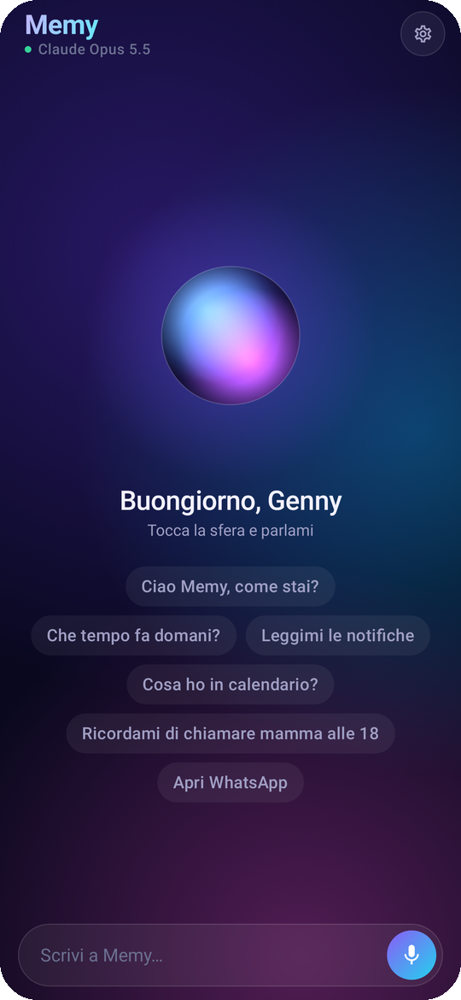
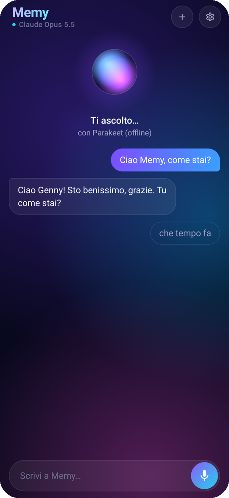
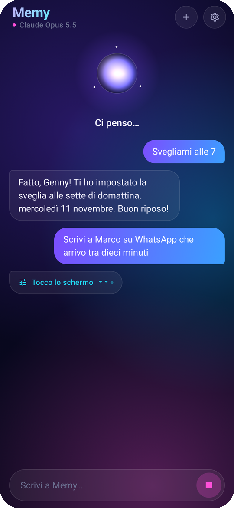
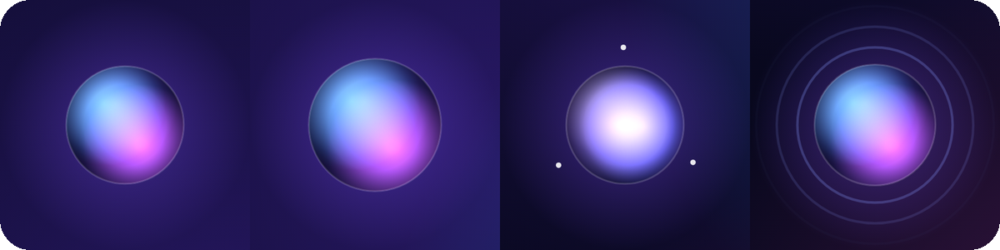

<h1 align="center">Memy</h1>

  <b>L'assistente che vive nel tuo telefono, ti ascolta e fa le cose al posto tuo.</b> 
  Le parli come a una persona. Lei capisce, agisce e ti risponde con una voce naturale.

  
  &nbsp;&nbsp;
  
  &nbsp;&nbsp;
  

  <a href="https://github.com/zsurann/Project-Nexa/releases/download/ultima-versione/Memy.apk"><b>Scarica Memy per Android</b></a>

---

## Basta dire «Ehi Memy»

Non serve aprire niente. Con il telefono in tasca, sul tavolo o a schermo spento, dici **«Ehi Memy»** e subito dopo
quello che ti serve, tutto d'un fiato:

> «Ehi Memy, scrivi a Marco che arrivo tra dieci minuti.»

Un breve segnale ti conferma che sta ascoltando. Il riconoscimento della parola avviene sul telefono: finché non la
chiami, nessun suono lascia il dispositivo. Se preferisci, puoi anche sceglierla come assistente del telefono e
richiamarla con il gesto o il tasto dedicato.

## Usa le app come faresti tu

Memy vede lo schermo, tocca, scrive e scorre. Per questo non è limitata a un elenco di comandi: se una cosa si può
fare con le dita, lei può farla con la voce.

| Tu dici | Memy fa |
|---|---|
| «Scrivi a Giulia su WhatsApp che sto arrivando» | Apre la chat, scrive il messaggio e te lo fa confermare prima di inviarlo |
| «Cerca un video di ricette su YouTube» | Apre l'app, cerca e ti mostra i risultati |
| «Attiva il Bluetooth e abbassa la luminosità» | Lo fa, senza farti entrare nelle impostazioni |
| «Cosa c'è scritto qui?» | Legge quello che hai sullo schermo e te lo spiega |

Lavora in silenzio: non ti racconta ogni passaggio. Parla quando ha finito, quando qualcosa non va, oppure quando
serve il tuo sì.

## Si occupa della tua giornata

- **Messaggi e notifiche** — te le legge, risponde al posto tuo, le cancella quando non servono più.
- **Tempo** — sveglie, timer, eventi in calendario, promemoria che arrivano all'ora giusta.
- **Telefono** — chiama un contatto, manda un SMS, ti dice chi ha chiamato.
- **Il mondo fuori** — meteo, notizie, risultati, prezzi: cerca sul web e ti riassume la risposta a voce.
- **Strada** — ti dice dove sei e ti porta dove vuoi andare.
- **Documenti** — scrive per te PDF, file Word, tabelle e pagine curate («fammi un PDF con la lista della spesa»),
  li modifica quando cambi idea, te li apre o li manda a chi vuoi. Se glielo permetti, legge anche i tuoi PDF e Word.
- **Piccole cose** — torcia, volume, musica, silenzioso, Non disturbare, fotocamera.

## Una conversazione vera

Memy non aspetta che tu finisca i convenevoli. Risponde mentre sta ancora pensando, frase dopo frase, e dopo ogni
risposta resta in ascolto: puoi continuare senza richiamarla.

Se sta parlando o lavorando e vuoi cambiare qualcosa, **parlale sopra**. Ascolta tutta la frase e, se hai detto
qualcosa di concreto, si ferma e ti segue; un rumore o un colpo di tosse non la interrompono.

E si ricorda di te. Dille una volta «mia sorella si chiama Giulia» e la prossima volta saprà a chi scrivere.

## Aurora, il nuovo volto di Memy

Al centro c'è una sfera di luce. È il modo in cui Memy ti fa capire, senza una parola, cosa sta succedendo.

  

<table align="center">
  <tr>
    <td align="center" width="205"><b>A riposo</b> respira piano</td>
    <td align="center" width="205"><b>Ti ascolta</b> si allarga con la tua voce</td>
    <td align="center" width="205"><b>Pensa</b> la luce si accende e tre punti le girano attorno</td>
    <td align="center" width="205"><b>Parla</b> manda onde verso l'esterno</td>
  </tr>
</table>

Intorno, tutto è stato alleggerito: uno sfondo profondo in cui i colori si muovono lentamente, superfici di vetro
sottile, una sola barra in basso per scrivere o parlare. Quando inizia una conversazione la sfera si fa piccola e
lascia spazio alle parole.

## Chiede prima di agire

Memy ha molto potere sul tuo telefono, e lo usa con giudizio.

- Prima di **inviare, chiamare, pagare, eliminare o pubblicare** qualcosa, si ferma e ti chiede conferma. Puoi
  rispondere a voce.
- Fa qualcosa **solo quando glielo chiedi tu**. Quello che legge in un messaggio o su una pagina web non è un ordine.
- Non inserisce mai password, PIN o dati di pagamento.
- Mentre lavora in un'altra app, un indicatore in alto ti dice che è all'opera: un tocco e si ferma.
- Sei tu a decidere quanto può fare, un potere alla volta.

## Sempre aggiornata

Quando esce una versione nuova, Memy la scarica e la installa da sola. Tu apri l'app e trovi le novità.

---

  
    Memy parla e ascolta in italiano. Pensa con Claude di Anthropic, ascolta con Whisper e con
    <a href="https://huggingface.co/nvidia/parakeet-tdt-0.6b-v3">NVIDIA Parakeet</a> (CC-BY-4.0),
    riconosce la sua parola di attivazione con <a href="https://github.com/k2-fsa/sherpa-onnx">sherpa-onnx</a>
    e <a href="https://github.com/snakers4/silero-vad">Silero VAD</a>, e parla con le voci neurali di Microsoft Edge.
  

