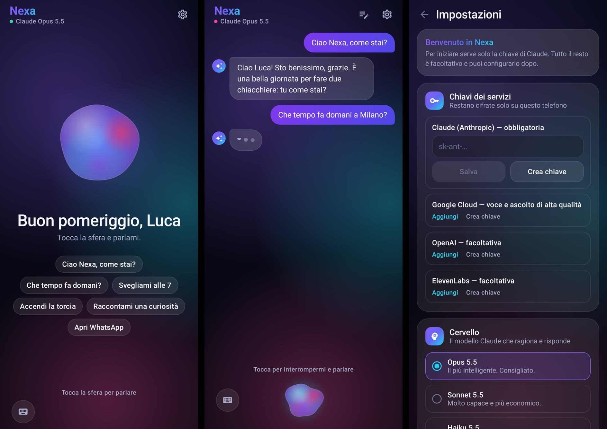

# Nexa — assistente vocale IA per Android

Nexa è un assistente vocale personale per Android. Gli parli, il "cervello" (Claude di Anthropic) capisce cosa vuoi e
Nexa agisce sul telefono: apre app, imposta sveglie, chiama, manda SMS, accende la torcia e tanto altro.
Poi ti risponde a voce.

Pensata per l'installazione diretta tramite APK, senza Play Store, e compatibile con telefoni **senza servizi Google**
(ad esempio vivo con OriginOS versione Cina).



## Cosa sa fare

| Comando di esempio | Cosa fa |
|---|---|
| "Che ore sono?" / "Quanta batteria ho?" | Legge data, ora, batteria e rete |
| "Apri WhatsApp" | Apre qualsiasi app installata |
| "Svegliami domani alle 7" | Imposta una sveglia (anche ripetuta) |
| "Timer di 10 minuti" | Avvia un timer |
| "Chiama Marco" | Cerca in rubrica e chiama, **dopo la tua conferma** |
| "Scrivi a Giulia che arrivo tra 5 minuti" | Prepara l'SMS e lo invia **dopo la tua conferma** |
| "Accendi la torcia" | Torcia accesa o spenta |
| "Alza il volume della musica al 70%" | Volume di media, suoneria, sveglia e notifiche |
| "Metti in pausa" / "Canzone successiva" | Controlla la musica in qualsiasi app |
| "Apri le impostazioni del Wi-Fi" | Apre le sezioni delle impostazioni |
| "Cerca su internet ricette di tiramisù" | Apre il browser |
| "Portami in piazza Duomo a Milano" | Apre le mappe |
| "Crea un evento dal dentista giovedì alle 15" | Prepara l'evento nel calendario |
| Domande generali | Risponde direttamente |

Le azioni delicate (chiamate e SMS) chiedono sempre conferma: rispondi "sì" o "no" a voce, oppure usa i pulsanti.

## Come funziona

```
Microfono → riconoscimento vocale → Claude (in streaming, con strumenti e ricerca web)
         → azioni sul telefono → voce neurale, frase per frase
```

- **Cervello**: Claude Opus 5.5 di default, il più intelligente. Nelle impostazioni puoi scegliere Sonnet 5.5 o Haiku 5.5.
  Con Opus e Sonnet Nexa può **cercare sul web** (meteo, notizie, risultati sportivi).
- **Streaming**: Nexa inizia a parlare appena ha scritto la prima frase, senza aspettare la risposta completa.
- **Conversazione continua**: dopo ogni risposta torna ad ascoltarti. Se tocchi la sfera mentre parla, la interrompi.

### Ascolto (riconoscimento vocale)

| Motore | Qualità | Note |
|---|---|---|
| Automatico | — | Sceglie il migliore disponibile |
| Google sul telefono | ★★★★ | Gratis, ma serve l'app Google: di solito manca sui telefoni cinesi |
| **Google Cloud** | ★★★★★ | 60 minuti al mese gratis, poi circa 0,016 $ al minuto. Serve una chiave Google Cloud |
| OpenAI | ★★★★★ | Circa 0,006 $ al minuto. Serve una chiave OpenAI |
| Offline (Vosk) | ★★ | Senza internet. Va scaricato il modello italiano (50 MB) |

### Voce (risposta)

| Voce | Qualità | Note |
|---|---|---|
| **Google Cloud Chirp 3 HD** | ★★★★★ | Voci italiane neurali, 1 milione di caratteri al mese gratis |
| OpenAI | ★★★★★ | Molto espressiva |
| ElevenLabs | ★★★★★ | La più realistica; piano gratuito limitato |
| Voce del telefono | ★★ | Gratis ma robotica |

#### Creare la chiave Google Cloud (una sola chiave per voce e ascolto)

1. Vai su <https://console.cloud.google.com>, crea un progetto e attiva la fatturazione: serve, ma le soglie gratuite
   coprono un uso personale.
2. In *API e servizi → Libreria* attiva **Cloud Text-to-Speech API** e **Cloud Speech-to-Text API**.
3. In *API e servizi → Credenziali* tocca **Crea credenziali → Chiave API**. Ti consiglio di limitarla a quelle due API.
4. Incollala in Nexa: *Impostazioni → Chiavi dei servizi → Google Cloud*. Poi scegli Google Cloud in "Ascolto" e in "Voce".

## Aggiornamenti automatici

Ogni push su GitHub compila l'APK e aggiorna la release "ultima-versione" con `Nexa.apk` e `version.json`.
All'apertura (al massimo ogni 30 minuti) Nexa legge `version.json`; se trova una versione più nuova la scarica e la
installa. La prima volta Android ti chiede di **consentire a Nexa di installare app**. Da Android 12, dopo il primo
aggiornamento installato da Nexa, i successivi possono avvenire senza conferma. Puoi disattivarli in
*Impostazioni → Aggiornamenti*.

## Installazione sul telefono

1. **Scarica l'APK**: dal telefono apri la pagina *Releases* di questo repository GitHub ("Nexa — ultima versione")
   e tocca `Nexa.apk`.
2. **Installa**: apri il file. Su OriginOS, se compare il "controllo di sicurezza" o il blocco delle app esterne,
   consenti l'installazione da questa fonte. Se il sistema vuole un account vivo per verificare l'app, puoi saltare
   o disattivare la verifica in *Impostazioni → Sicurezza*.
3. **Sblocca le impostazioni con restrizioni** (Android 13 e successivi, solo se un permesso risulta bloccato):
   *Impostazioni → App → Nexa → ⋮ (in alto a destra) → Consenti impostazioni con restrizioni*.
4. **Apri Nexa** e segui le impostazioni, numerate da 1 a 7:
   1. Incolla la chiave API (la crei su <https://console.anthropic.com/settings/keys>, dopo aver ricaricato qualche euro).
   2. Tocca **Scarica voce italiana**.
   3. Controlla la **voce di risposta**. Se il telefono non ha una voce italiana, installa un motore di sintesi
      vocale, come *sherpa-onnx TTS Engine* (con una voce italiana) o *RHVoice*, e impostalo come motore
      preferito nelle impostazioni di sintesi vocale.
   4. Scegli il modello (Haiku è consigliato).
   5. Concedi i permessi.
   6. **Ottimizzazione OriginOS**: consenti il consumo della batteria in background, attiva l'avvio automatico e
      blocca Nexa nelle app recenti (tieni premuta la scheda e tocca il lucchetto).
5. **Avvio rapido**: apri le Impostazioni rapide (scorri dall'alto), tocca modifica e aggiungi il riquadro
   **"Ehi Nexa"**. Un tocco e Nexa ti ascolta.

Per gli aggiornamenti basta scaricare e installare il nuovo `Nexa.apk` sopra quello vecchio: impostazioni e voce
restano dove sono.

## Compilare da soli

Servono JDK 17 o successivo e l'SDK Android (piattaforma 36).

```bash
./gradlew :app:testDebugUnitTest --tests 'com.nexa.assistant.agent.*'   # test dell'agente (server Claude finto)
./gradlew :app:testDebugUnitTest --tests '*ScreenshotTest*'             # immagini dell'interfaccia in app/build/screenshots
./gradlew :app:assembleRelease                                          # APK in app/build/outputs/apk/release/
```

Ogni push su GitHub compila l'APK in automatico (`.github/workflows/build-apk.yml`) e lo pubblica nella release
"ultima-versione".

### Firma dell'APK

Il file `keystore/nexa-debug.jks` è una chiave di firma **di sviluppo** inclusa nel repository: così ogni APK
compilato si installa sopra il precedente. Se il repository è pubblico, chiunque può firmare un APK "Nexa" con la
stessa chiave. Per uso personale va bene, ma puoi usare una chiave privata: crea un nuovo keystore e imposta le
variabili d'ambiente `NEXA_KEYSTORE_PASSWORD`, `NEXA_KEY_ALIAS` e `NEXA_KEY_PASSWORD`, ad esempio come
*secrets* di GitHub Actions. Dopo il cambio di chiave dovrai disinstallare una volta la versione vecchia.

## Struttura del codice

```
app/src/main/java/com/nexa/assistant/
├── NexaApp.kt              # Application: contiene impostazioni e controller
├── NexaController.kt       # Coordina ascolto → Claude → azioni → voce, e le conferme sì/no
├── MainActivity.kt         # Avvio, permesso microfono, avvio da assistente o riquadro rapido
├── NexaTileService.kt      # Riquadro "Ehi Nexa" nelle Impostazioni rapide
├── agent/
│   ├── NexaAgent.kt        # Ciclo con Claude (SDK ufficiale Anthropic): strumenti e risultati
│   └── SystemPrompt.kt     # Personalità e regole di Nexa
├── tools/
│   ├── NexaTool.kt         # Interfaccia degli strumenti
│   └── PhoneTools.kt       # Gli strumenti della Fase 1
├── speech/                 # Ascolto (Google, Google Cloud, OpenAI, Vosk) e voci (Google, OpenAI, ElevenLabs)
├── update/                 # Aggiornamento automatico da GitHub
├── data/                   # Impostazioni e chiave API cifrata con l'Android Keystore
└── ui/                     # Interfaccia Jetpack Compose
```

Per aggiungere uno strumento basta implementare `NexaTool` e registrarlo in `phoneTools()`.

## Prossime fasi

- **Fase 2**: lettura e risposta alle notifiche (WhatsApp, Telegram…), calendario completo, memoria delle preferenze.
- **Fase 3**: agente sullo schermo con il servizio di accessibilità. Nexa legge lo schermo, tocca e scrive nelle app
  al posto tuo ("apri WhatsApp e scrivi a Marco…").
- **Fase 4**: sempre in ascolto con la parola di attivazione "Ehi Nexa" e ruolo di assistente predefinito.
- **Fase 5** (facoltativa): Shizuku per i comandi di sistema avanzati.
